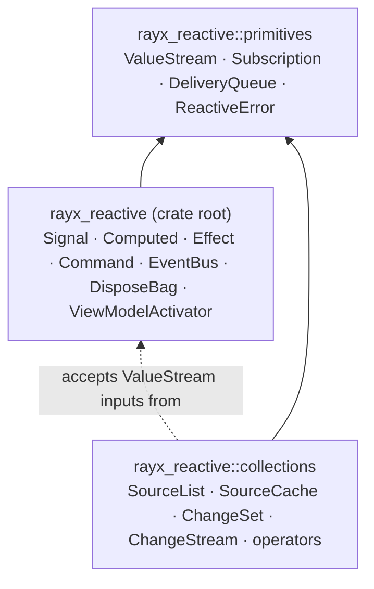

# 1. Introduction and architecture

`rayx_reactive` is the state layer of a Model-View-ViewModel (MVVM) application, packaged as a
library with no UI dependency. It answers one question: *when application state changes, how does
everything that depends on it find out, cheaply and in the right order?*

It answers that question with two families of types:

- **Scalar state** for single current values: the search text, the selected id, a loading flag, the
  result of a calculation, whether a command may run.
- **Observable collections** for sets of items: rows in a grid, messages in a feed, nodes in a tree.
  A collection does not announce "something changed, re-read everything". It announces *exactly
  what changed* (this item was added at index 3, that key was updated, these two rows moved) so a
  view can apply the delta instead of rebuilding.

## Design principles

The library follows a small set of rules, and they explain most of its API decisions.

| Principle | Consequence |
|---|---|
| **UI-neutral** | Nothing depends on a UI framework. Scheduling onto a UI thread is the consumer's job; RayX does it for GPUI. |
| **Push-based and synchronous** | A write publishes immediately. Subscribers run during the write call, on the writing thread, unless an operator deliberately moves work to a timer or worker thread. |
| **Explicit dependencies** | `Computed` tracks only the signals you pass it. There is no implicit dependency tracking, so there are no hidden subscriptions. |
| **Incremental by default** | Collections emit `ChangeSet` batches of typed changes. Operators keep internal state so they can translate each batch into the smallest downstream batch. |
| **Batches are the unit of consistency** | One `edit` produces one batch. Every subscriber sees the whole batch or nothing, and batches arrive in commit order. |
| **RAII lifetimes** | Subscribing returns a `Subscription`. Dropping it tears the pipeline down, including every per-item child subscription the operators own. |
| **Re-entrancy is safe** | Delivery goes through FIFO queues. A subscriber that writes back into state enqueues its change behind the current one instead of recursing. Nested edits of the same source are rejected with an error instead of deadlocking. |
| **Errors are values** | Streams have no Rx-style error or completion channel. Fallible APIs return `Result`; domain failures live in your value types, `CommandState`, or the error callback of a `transform_safe*` operator. |
| **Thread-safe, no `unsafe`** | All handles are `Send + Sync`, built on `Arc` and `Mutex`. The crate forbids `unsafe_code`. |

## The three layers



1. **Primitives** (`rayx_reactive::primitives`). The neutral stream and disposal machinery that
   both other layers share: the cold `ValueStream<T, E>`, the RAII `Subscription`, the re-entrancy
   safe fan-out `DeliveryQueue<T>`, and `ReactiveError`.
2. **Scalar state** (the crate root, also exported as `rayx_reactive::prelude`). Signals, computed
   values, effects, commands, events, and lifetime management. This layer never depends on
   collections.
3. **Collections** (`rayx_reactive::collections`). Sources, change sets, change streams, and the
   operator library. Collection operators accept `ValueStream`s for dynamic inputs (a predicate,
   a page request, a sort comparer), and a `Signal`'s `values()` stream is the usual way to supply
   them.

The dependency rule is strict: primitives depend on nothing, scalar state depends only on
primitives, and collections depend on primitives. A ViewModel freely owns both signals and
sources; the library itself never couples them.

## Module map

### Crate root

| Module | Contents |
|---|---|
| `signal` | `Signal<T>`, `ReadSignal<T>`, `SignalChange<T>` |
| `computed` | `Computed<T>` (`derive`, `combine2`) |
| `stream_ext` | `ReactiveValueStreamExt`: `filter`, `filter_map`, `distinct_until_changed`, `skip` |
| `effect` | `Effect` |
| `disposal` | `Disposable`, `DisposeBag`, `DisposeWith` |
| `activation` | `ViewModelActivator`, `ActivationToken`, `ActivatableViewModel` |
| `command` | `Command`, `AsyncCommand`, `CommandState`, `CommandError`, `CommandResult` |
| `event` | `EventBus<T>`, `EventStream<T>` |
| `primitives` | `ValueStream`, `ValueSubscriber`, `Subscription`, `CompositeSubscription`, `DeliveryQueue`, `ConnectionStatus`, `ReactiveError`, `Result` |

### `rayx_reactive::collections`

| Area | Modules | Key items |
|---|---|---|
| Change model | `change` | `ChangeSet`, `ListChange`, `CacheChange`, `ChangeReason`, `ListChangeReason`, `ListItemChange`, `PageRequest`/`PageResponse`, `VirtualRequest`/`VirtualResponse`, page and virtual change sets |
| Sources | `list`, `cache` | `SourceList`, `ListUpdater`, `SourceCache`, `CacheUpdater`, notification suspension guards |
| Streams | `stream`, `subscription`, `delivery` | `ChangeStream<C>`, collection `ValueStream<T>` alias, stream controls (`batch`, `buffer_initial`, …) |
| Core operators | `operators` | `ListStreamExt`, `CacheStreamExt`, `CacheArcStreamExt`, `Predicate`, `Comparer`, `GroupSelector`, `CacheForceTransform`, `IndexAware`, `TransformAsyncOptions` |
| Groups | `group`, `list_group`, `projection` | `RayCacheGroup`, `ImmutableCacheGroup`, `RayListGroup`, `ImmutableListGroup`, `RayGroup` |
| Relations | `join`, `combine`, `tree`, `true_for`, `distinct` | `CacheJoinExt`, `CombineOperator`, `CacheCombineExt` and list/dynamic variants, `CacheTreeExt`, `TreeNode`, `CacheTrueForExt`, `ListDistinctExt`/`CacheDistinctExt` |
| Item lifecycle | `lifecycle` | `ListLifecycleExt`, `CacheLifecycleExt`, `DisposeItem`, `AsyncDisposeItem`, `EvaluateItem`, `ItemValue`, `KeyedItemValue` |
| Aggregation | `aggregation` | `ListAggregationExt`, `CacheAggregationExt`, `CacheQuery` |
| Materialization | `observable_list`, `observable_cache` | `ObservableList`, `ObservableCache`, `as_observable_list`, `as_observable_cache` |
| Population | `populate`, `factory`, `diff`, `merge` | `populate_into`, `populate_from`, `to_*_change_set`, `ChangeSetAdapterOptions`, `create_*_change_stream`, `edit_diff*`, `merge_*_change_sets` |
| Bounding | `limit`, `expiration` | `limit_size_to`, `expire_after` |
| Composition | `switch`, `ref_count` | `switch`, `ref_count` |
| Utilities | `side_effect`, `type_filter`, `option`, `transform_error`, `error` | `for_each_*`, `of_type`, `Option` helpers, `TransformError`, `CollectionError` |
| Diagnostics | `diagnostics` (feature `diagnostics`) | `collect_update_stats`, `ChangeSummary`, `ChangeStatistics`, `retained_implicit_batch_count` |

## Imports and name collisions

Each layer has a prelude:

<!-- skip-check -->
```rust
use rayx_reactive::prelude::*;              // also re-exported at the crate root
use rayx_reactive::collections::prelude::*; // also re-exported at rayx_reactive::collections
```

Both preludes can be glob-imported together, with two names to watch:

| Name | `rayx_reactive::prelude` | `rayx_reactive::collections::prelude` |
|---|---|---|
| `ValueStream` | `ValueStream<T, E = ReactiveError>` (the struct) | `ValueStream<T>`, an alias for `ValueStream<T, CollectionError>` |
| `Result` | `Result<T, ReactiveError>` | `Result<T, CollectionError>` |

The two `ValueStream` names refer to the same struct with different error parameters. Rust only
reports an ambiguity when you *use* an ambiguous name, so code that imports both preludes should
spell these two out (`rayx_reactive::ValueStream`, `rayx_reactive::collections::Result`) or
import specific items. `Subscription` and `ConnectionStatus` are the same items in both
preludes and never conflict.

A glob import of either prelude also **shadows `std::result::Result`**, because each prelude's
`Result` is a one-parameter alias. Write `std::result::Result<T, E>` when you need the
two-parameter form in such a module. Within collection code, the alias is often what you want:
`CollectionError` converts from `ReactiveError`, so a function returning
`rayx_reactive::collections::Result<T>` can use `?` on both layers.

The error parameter rarely matters in practice: every collection operator accepts streams of any
error type convertible into `CollectionError`, and every scalar stream operator works with any
error type, so `signal.values()` feeds collection operators directly and collection outputs use
the scalar operators unchanged. See
[Application patterns](15-application-patterns.md#feeding-signals-into-collection-operators).

## Errors

| Type | Variants | Raised by |
|---|---|---|
| `ReactiveError` | `Poisoned`, `External(Arc<dyn Error + Send + Sync>)` | Scalar state. `External` carries an error from another layer, for example a `CollectionError` converted with `?`. |
| `CollectionError` | `Poisoned`, `MissingKey`, `IndexOutOfRange`, `NestedUpdate`, `Contended` | Collections. `NestedUpdate` means a source was accessed from inside its own edit on the same thread; `Contended` (wasm32 only) means another thread holds it. |
| `CommandError` | `Disabled`, `Failed(String)`, `Reactive(ReactiveError)` | `Command::execute` / `AsyncCommand::execute`. |
| `TransformError<K, T, E>` | struct `{ error, key, value }` | Passed to the error callback of `transform_safe*` operators. |

`CollectionError` and `ReactiveError` convert into each other (a collection error inside
`ReactiveError::External` converts back to itself), and `CommandError` implements
`From<ReactiveError>`, so `?` works across the layers in both directions. All error types implement
`std::error::Error`.

## What this library is not

- **Not a UI framework.** It never touches widgets, windows or a render loop. See
  [Application patterns](15-application-patterns.md#binding-to-a-ui) for how to connect it to one.
- **Not an async runtime.** Streams are synchronous callbacks. `AsyncCommand::execute` returns a
  future that you drive on your own executor. Async collection operators drive their futures on
  private worker threads.
- **Not implicit fine-grained reactivity.** Unlike signal systems that track reads automatically,
  every dependency here is an explicit subscription that you can see and drop.
- **Not a general Rx library.** `ValueStream` deliberately has no completion or error terminal.
  Sources expose an [rxRust](https://github.com/rxRust/rxRust) subject (`changes_rx()`) when you
  need Rx interop.

## Lineage

The collection layer follows the behavior of .NET's
[DynamicData](https://github.com/reactivemarbles/DynamicData), adapted to Rust: closures instead
of overload families, `Result` instead of exceptions, explicit ownership instead of garbage
collection, and zero-based paging. The scalar layer follows the ReactiveUI vocabulary (commands,
activation, `WhenActivated`) without its runtime. [Chapter 19](19-coming-from-dynamicdata.md) maps
the two APIs side by side.

---

Next: [Getting started →](02-getting-started.md)
