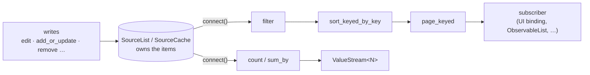

# 7. Observable collections: fundamentals

A `Signal<Vec<T>>` can hold a list, but every change replaces the whole vector, so every observer
must diff, re-filter, re-sort and re-render everything. Observable collections avoid that. A source
collection publishes **what changed**, and each operator downstream maintains just enough state to
translate that delta into its own delta. A filtered, sorted, paged grid over 100,000 rows receives
"row 42 was updated and moved from position 7 to position 3", not 100,000 rows.

## The model



- A **source** (`SourceList<T>` or `SourceCache<K, T>`) owns mutable state. It is the only place
  writes happen.
- `connect()` returns a **`ChangeStream`**: a cold description of a stream of change sets.
- **Operators** (`filter`, `transform`, `sort_*`, `group`, `page_*`, …) take a change stream and
  return a new one. Each subscription to the final stream builds its own operator chain with its
  own state.
- **Subscribers** receive `&ChangeSet<C>` batches. They either apply the changes themselves (a UI
  binding) or use a materializer such as `as_observable_list()` or `bind_to_vec()`.
- **Aggregates** (`count`, `sum_by`, `max_by`, …) reduce a change stream to a `ValueStream` of
  scalars.

## Change sets

<!-- skip-check -->
```rust
pub struct ChangeSet<C> {
    pub changes: Vec<C>,
    pub version: u64,
}
```

A `ChangeSet` is one atomic batch. One source `edit` produces exactly one change set, and every
subscriber receives the whole batch or nothing. Change sets iterate (`IntoIterator`), expose
`is_empty()`, and derive `Clone`, `Debug`, `PartialEq` and serde's `Serialize`/`Deserialize`.

**Changes inside a batch apply in order.** Each change's index refers to the collection as it
stands after all earlier changes in the same batch. A subscriber that applies changes front to back
always stays consistent.

### `ListChange<T>`: position-first changes

| Variant | Meaning |
|---|---|
| `Add { index, item }` | Insert `item` at `index`. |
| `AddRange { index, items }` | Insert `items` starting at `index`. |
| `Replace { index, old, new }` | The item at `index` was replaced. |
| `Move { from, to, item }` | Remove the item at `from`, then insert it at `to`. |
| `Remove { index, old }` | Remove the item at `index`. |
| `RemoveRange { index, old }` | Remove `old.len()` items starting at `index`. |
| `Refresh { index, item }` | The item at `index` should be re-evaluated (it may have changed internally). |
| `Clear { old }` | Remove everything; `old` holds the removed items. |

### `CacheChange<K, T>`: identity-first changes

| Variant | Meaning |
|---|---|
| `Add { key, current, current_index }` | A new key. |
| `Update { key, current, previous, current_index, previous_index }` | An existing key's value was replaced. |
| `Remove { key, previous, previous_index }` | A key was removed. |
| `Refresh { key, current, current_index }` | The value under `key` should be re-evaluated. |
| `Move { key, current, current_index, previous_index }` | The key changed position in an ordered view. |
| `Clear { previous }` | Every `(key, value)` pair was removed. |

Cache indexes are `Option<usize>`. A `SourceCache` keeps its keys in insertion order (or the order
you set with `move_key`) and fills in indexes. Sorted and windowed keyed operators rewrite them to
positions in their own ordered output. Some operators cannot know positions and emit `None`.
Several subset operators (for example cache `filter`) currently forward source positions instead;
see [Known issues](README.md#known-issues).
Consumers that only care about identity can ignore indexes.

An `Update` from an ordered keyed stream can carry `previous_index != current_index`. Treat that as
"remove at the previous index, insert at the current index", not as an in-place replacement.

### Reasons

`ListChange::reason()` returns a `ListChangeReason` (`Add`, `AddRange`, `Replace`, `Remove`,
`RemoveRange`, `Refresh`, `Move`, `Clear`), and `CacheChange::reason()` returns a `ChangeReason`
(`Add`, `Update`, `Remove`, `Refresh`, `Move`, `Clear`). Reason filters such as
`where_reasons_are` work with these enums; see
[chapter 13](13-stream-control-and-aggregation.md#filtering-by-change-reason).

### What a source emits

```rust
use rayx_reactive::collections::prelude::*;
use std::sync::{Arc, Mutex};

let list = SourceList::new(vec!["a", "b"]);
let batches = Arc::new(Mutex::new(Vec::new()));
let sink = Arc::clone(&batches);
let _subscription = list.connect().subscribe(move |batch| sink.lock().unwrap().push(batch.clone()))?;

list.edit(|items| {
    items.push("c");
    items.push("d"); // adjacent appends coalesce into one AddRange
    items.remove(0);
})?;

let batches = batches.lock().unwrap();
assert_eq!(batches[0].changes, [ListChange::AddRange { index: 0, items: vec!["a", "b"] }]);
assert_eq!(
    batches[1].changes,
    [
        ListChange::AddRange { index: 2, items: vec!["c", "d"] },
        ListChange::Remove { index: 0, old: "a" },
    ]
);
```

And a cache:

```rust
use rayx_reactive::collections::prelude::*;
use std::sync::{Arc, Mutex};

#[derive(Clone, Debug, PartialEq)]
struct User {
    id: u32,
    name: &'static str,
}

let users = SourceCache::new(|user: &User| user.id);
users.add_or_update(User { id: 1, name: "ada" })?;

let batches = Arc::new(Mutex::new(Vec::new()));
let sink = Arc::clone(&batches);
let _subscription = users.connect().subscribe(move |batch| sink.lock().unwrap().push(batch.changes.clone()))?;

users.edit(|cache| {
    cache.add_or_update(User { id: 2, name: "alan" });
    cache.add_or_update(User { id: 1, name: "ada l." });
})?;

let batches = batches.lock().unwrap();
assert_eq!(
    batches[0], // the snapshot
    [CacheChange::Add { key: 1, current: User { id: 1, name: "ada" }, current_index: Some(0) }]
);
assert_eq!(
    batches[1],
    [
        CacheChange::Add { key: 2, current: User { id: 2, name: "alan" }, current_index: Some(1) },
        CacheChange::Update {
            key: 1,
            current: User { id: 1, name: "ada l." },
            previous: User { id: 1, name: "ada" },
            current_index: Some(0),
            previous_index: Some(0),
        },
    ]
);
```

## Change streams

`ChangeStream<C>` is to change sets what `ValueStream` is to values. It is cold, cloneable and
`Send + Sync`, and `subscribe` returns a `collections::Result<Subscription>`.

```rust
use rayx_reactive::collections::prelude::*;
use std::sync::{Arc, Mutex};

let numbers = SourceList::new(vec![1, 2, 3, 4]);
let evens = numbers.connect().filter(|n| n % 2 == 0); // nothing runs yet

let seen = Arc::new(Mutex::new(Vec::new()));
let sink = Arc::clone(&seen);
let subscription = evens.subscribe(move |batch| sink.lock().unwrap().push(batch.changes.clone()))?;

numbers.push(6)?;
drop(subscription); // tears down the filter's state
numbers.push(8)?;

assert_eq!(seen.lock().unwrap().len(), 2); // the snapshot and the push of 6
```

Because each subscription builds its own operator chain, two subscribers to the same derived stream
run the operators twice. Share an expensive chain with
[`ref_count`](14-materialization-population-sharing.md#sharing-a-pipeline-ref_count) or materialize
it once with `as_observable_list` / `as_observable_cache`.

## `connect`, `changes` and `preview`

| Method | First emission | Then | Use |
|---|---|---|---|
| `connect()` | a snapshot batch of the current items (if any) | every later batch | almost always |
| `changes()` | nothing | every later batch | when the subscriber already knows the current state |
| `preview()` | nothing | every later batch, delivered before `changes()` / `connect()` subscribers see it | pre-delivery observation (logging, validation) |

`connect()` is race-free. It registers for live batches *before* taking the snapshot, buffers live
batches until the snapshot has been delivered, and drops any buffered batch whose version is
already covered by the snapshot. With a single writer thread you never miss a change and never see
one twice, even when the write happens on another thread during the connect. Concurrent writers on
several threads and connecting during `suspend_notifications` are current exceptions; see
[Known issues](README.md#known-issues).

### Empty sources emit no snapshot

If the source is empty, `connect()` emits nothing until the first change. A subscriber that must
render an initial "no items" state, or a stream control that waits for the first batch
(`monitor_status`, `defer_until_loaded`), can start the stream with an empty batch.

Scalar aggregates behave the same way: `count()` emits only when the count *changes*, so it never
reports `0` for a source that has always been empty. Seed it with `start_with(0)`, or use
`is_empty()`, which emits `true` immediately.

```rust
use rayx_reactive::collections::prelude::*;
use std::sync::{Arc, Mutex};

let inbox = SourceList::<String>::default();

let batches = Arc::new(Mutex::new(Vec::new()));
let sink = Arc::clone(&batches);
let _raw = inbox
    .connect()
    .start_with_empty()
    .subscribe(move |batch| sink.lock().unwrap().push(batch.changes.len()))?;

let plain = Arc::new(Mutex::new(Vec::new()));
let sink = Arc::clone(&plain);
let _plain = inbox.connect().count().subscribe(move |n| sink.lock().unwrap().push(*n))?;

let seeded = Arc::new(Mutex::new(Vec::new()));
let sink = Arc::clone(&seeded);
let _seeded = inbox.connect().count().start_with(0).subscribe(move |n| sink.lock().unwrap().push(*n))?;

inbox.push("hello".into())?;

assert_eq!(*batches.lock().unwrap(), [0, 1]); // an empty batch, then the push
assert_eq!(*plain.lock().unwrap(), [1]);
assert_eq!(*seeded.lock().unwrap(), [0, 1]);
```

With a non-empty source, `start_with(0)` produces a transient `0` before the snapshot count
arrives. Both values are delivered synchronously during `subscribe`, so a view that renders after
`subscribe` returns never paints the intermediate value.

## Versions

Every non-empty edit increments the source's version, and the batch carries it. The snapshot from
`connect()` carries the source's current version. Operators forward or assign versions for their
own output. Treat versions as monotonically increasing per stream and use them for staleness
checks, not as indexes.

## Applying change sets yourself

A UI binding, or any custom materializer, applies changes front to back. This reference
implementation of the list semantics is complete:

```rust
use rayx_reactive::collections::prelude::*;

fn apply<T: Clone>(target: &mut Vec<T>, batch: &ChangeSet<ListChange<T>>) {
    for change in &batch.changes {
        match change {
            ListChange::Add { index, item } => target.insert(*index, item.clone()),
            ListChange::AddRange { index, items } => {
                target.splice(*index..*index, items.iter().cloned());
            }
            ListChange::Replace { index, new, .. } => target[*index] = new.clone(),
            ListChange::Move { from, to, .. } => {
                let item = target.remove(*from);
                target.insert(*to, item);
            }
            ListChange::Remove { index, .. } => {
                target.remove(*index);
            }
            ListChange::RemoveRange { index, old } => {
                target.drain(*index..*index + old.len());
            }
            ListChange::Refresh { .. } => {} // re-render the row at `index`
            ListChange::Clear { .. } => target.clear(),
        }
    }
}

let source = SourceList::new(vec![5, 3, 8]);
let mirror = std::sync::Arc::new(std::sync::Mutex::new(Vec::new()));
let target = std::sync::Arc::clone(&mirror);
let _subscription = source
    .connect()
    .sort_by_key(|n| *n)
    .subscribe(move |batch| apply(&mut target.lock().unwrap(), batch))?;

source.edit(|list| {
    list.push(1);
    list.replace(0, 9); // 5 -> 9
    list.remove(1);     // removes 3
})?;

assert_eq!(*mirror.lock().unwrap(), [1, 8, 9]);
```

You rarely need to write this yourself: `bind_to_vec`, `as_observable_list` and `as_observable_cache`
do it for you (see [chapter 14](14-materialization-population-sharing.md)). UI bindings use the same
structure to translate each change into a row insert, removal, move or redraw.

## Refresh

`Refresh` means "this item may have changed internally; re-evaluate it". It matters when items are
shared handles with interior mutability (for example `Arc<RowViewModel>` holding signals) and
replacing the item is not appropriate. Operators react to refreshes:

- filters re-test the item, so a refresh can become an add or a remove downstream;
- `sort_*_with_resort` and keyed sorts can move the item;
- groupers can move it to another group;
- default transforms forward the existing projection, and `transform_on_refresh` recomputes it.

Issue refreshes with `SourceList::refresh(index)` / `refresh_all()` and
`SourceCache::refresh_key(&key)` / `refresh_items(…)` / `refresh()`, or let
[`auto_refresh`](12-item-lifecycle.md#auto-refresh) inject them when a per-item stream fires.

## Lists or caches?

| Choose `SourceList<T>` when | Choose `SourceCache<K, T>` when |
|---|---|
| order *is* the data (a log, a chat feed, a playlist) | items have a stable identity (an id, a path, a primary key) |
| duplicates are meaningful | each key appears at most once |
| there is no natural key | you will update items by key, join, watch a key, or keep row state across sorts |
| the collection is small or append-mostly | you need keyed sorting, keyed paging, trees, or joins |

Bridges exist in both directions: `ListStreamExt::add_key(selector)` turns list changes into cache
changes, and `CacheStreamExt::remove_key()` turns cache changes into ordered list changes. Most
applications model domain data as caches and materialize ordered lists only at the view boundary.

## Item requirements

| Bound | Required for |
|---|---|
| `T: Clone + Send + Sync + 'static` | all sources and operators |
| `K: Clone + Eq + Hash + Send + Sync + 'static` | cache keys |
| `T: PartialEq` | many operators (sorting, paging, de-duplication, `edit_diff`, `add_or_update_if_changed`) |
| `G: Clone + Eq + Hash` | group keys |
| `S: Ord` | sort keys for `sort_*_by_key` |

Items are cloned into change sets and operator state, so keep them cheap to clone. Use `Arc<T>`
for large payloads; `CacheArcStreamExt::ignore_same_reference_update()` then lets you drop updates
that reuse the same allocation.

---

← [Commands and events](06-commands-and-events.md) · Next: [`SourceList` and `SourceCache` →](08-sources.md)
