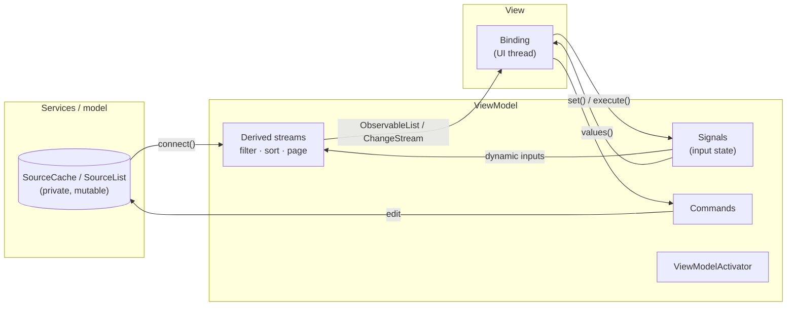

# 15. Application patterns

The previous chapters described the building blocks. This chapter shows how they fit together in
an application: how to layer state, how to connect scalar state with collections, how to bind to a
UI, and complete recipes for common screens.

## Layering



- **Services own sources.** Keep `SourceCache`/`SourceList` private; expose `connect()` streams or
  [observable wrappers](14-materialization-population-sharing.md#observable-wrappers).
- **ViewModels own input state and derivations.** Signals hold what the user controls (search,
  sort, page, selection). Derived collection pipelines combine service streams with those signals.
  Commands perform actions.
- **Views bind and forward input.** A view subscribes, usually inside an activation, applies
  updates on the UI thread, and writes user input back through `Signal::set` or
  `Command::execute`.

## Feeding signals into collection operators

Scalar state and collections use different error types for their streams (see
[Imports and name collisions](01-introduction.md#imports-and-name-collisions)):

| Stream | Type |
|---|---|
| `signal.values()`, `computed.values()`, `event_stream.values()` | `rayx_reactive::ValueStream<T>` (error `ReactiveError`) |
| collection operator inputs and outputs | `rayx_reactive::collections::ValueStream<T>` (error `CollectionError`) |

Which operators take which:

| Accepts any error convertible into `CollectionError` (pass `signal.values()` directly) | Requires the collection flavor (adapt first) |
|---|---|
| `filter_with_state`, `filter_dynamic` | `sort_dynamic*`, `sort_keyed_dynamic*`, `*_with_resort`, `page_dynamic*`, `page_keyed_dynamic*`, `virtualize_dynamic*`, `virtualize_keyed_dynamic*`, `sort_and_*_dynamic*`, `batch_if*`, `buffer_if*`, `group_dynamic*`, `*_with_regrouper`, `transform_*_forced*`, `transform_to_tree_with_predicate`, `switch`, per-item selectors (`auto_refresh`, `filter_on_observable`, `merge_many`, `true_for_*`, …), `to_*_change_set*`, `edit_diff*` bridges, `populate_from*` |

The adapter is one function. Because `CollectionError` implements `From<ReactiveError>`, the
conversion is lossless:

```rust
use rayx_reactive::collections::prelude::*;
use rayx_reactive::prelude::Signal;

/// Adapts a scalar-state stream to the collection stream flavor.
fn collection_stream<T: Send + Sync + 'static>(
    stream: rayx_reactive::ValueStream<T>,
) -> rayx_reactive::collections::ValueStream<T> {
    rayx_reactive::collections::ValueStream::new(move |subscriber| {
        Ok(stream.subscribe(move |value| subscriber(value))?)
    })
}

let rows = SourceList::new((1..=100).collect::<Vec<u32>>());
let page = Signal::new(PageRequest::new(0, 10));
let visible = rows.connect().page_dynamic(collection_stream(page.values())).as_observable_list()?;

page.set(PageRequest::new(3, 10))?;
assert_eq!(visible.items()?.first(), Some(&31));
```

The opposite direction lets collection outputs use the scalar operators (`filter`, `skip`,
`distinct_until_changed`) or `Effect::watch`. It is lossy, because `ReactiveError` has a single
variant:

```rust
use rayx_reactive::collections::prelude::*;
use rayx_reactive::prelude::{Effect, ReactiveError, ReactiveValueStreamExt};
use std::sync::{Arc, Mutex};

/// Adapts a collection stream to the scalar flavor. Setup errors collapse to `Poisoned`.
fn reactive_stream<T: Send + Sync + 'static>(
    stream: rayx_reactive::collections::ValueStream<T>,
) -> rayx_reactive::ValueStream<T> {
    rayx_reactive::ValueStream::new(move |subscriber| {
        stream
            .subscribe(move |value| subscriber(value))
            .map_err(|_| ReactiveError::Poisoned)
    })
}

let inbox = SourceList::<&str>::default();
let unread_badges = Arc::new(Mutex::new(Vec::new()));
let sink = Arc::clone(&unread_badges);
let _badge = Effect::watch(
    &reactive_stream(inbox.connect().count()).filter(|count| *count > 0),
    move |count| sink.lock().unwrap().push(*count),
)?;

inbox.add_range(["a", "b"])?;
inbox.clear()?;
assert_eq!(*unread_badges.lock().unwrap(), [2]); // 0 was filtered out
```

### Mirroring a collection value into a signal

Commands and `Computed` read `ReadSignal`s. To use a collection aggregate there (for example "the
command is enabled when every row is valid"), mirror it into a signal and keep the subscription
next to the signal:

```rust
use rayx_reactive::collections::prelude::*;
use rayx_reactive::prelude::{Command, Signal, Subscription};

struct Cart {
    lines: SourceCache<u32, (u32, u32)>, // (sku, quantity)
    has_items: Signal<bool>,
    checkout: Command,
    _mirror: Subscription,
}

impl Cart {
    fn new() -> Result<Self> {
        let lines = SourceCache::new(|line: &(u32, u32)| line.0);
        let has_items = Signal::new(false);
        let mirror = {
            let has_items = has_items.clone();
            lines.connect().is_not_empty().subscribe(move |value| {
                let _ = has_items.set(*value);
            })?
        };
        let checkout = Command::with_can_execute(has_items.read_only(), || Ok(()));
        Ok(Self { lines, has_items, checkout, _mirror: mirror })
    }
}

let cart = Cart::new()?;
assert!(!cart.checkout.can_execute().get()?);
cart.lines.add_or_update((7, 1))?;
assert!(cart.checkout.can_execute().get()?);
```

## Binding to a UI

`rayx_reactive` does not know about UI threads. A binding has three responsibilities:

1. **Own the subscription** for as long as the view exists, ideally inside
   `ViewModelActivator::when_activated`, so a hidden view stops receiving updates.
2. **Marshal to the UI thread.** Subscribers run on the writer's thread, or on a worker or timer
   thread for async and timed operators. Most UI toolkits require widget updates on one thread.
3. **Apply changes incrementally.** For collections, translate each change into a row insert,
   removal, move or refresh. For scalars, update the bound property.

Toolkit integrations package these steps. RayX's `ReactiveContextExt` (in `rayx::reactive`)
schedules stream values onto GPUI's foreground executor and binds `ObservableList`s to its
virtualized list and tree views. For any other toolkit, a channel works as the marshalling
boundary:

```rust
use rayx_reactive::collections::prelude::*;
use std::sync::mpsc;

// Producer side: the subscriber may run on any thread, so it only sends.
let rows = SourceList::new(vec!["alpha", "beta"]);
let (to_ui, ui_inbox) = mpsc::channel::<ChangeSet<ListChange<&str>>>();
let _binding = rows.connect().subscribe(move |batch| {
    let _ = to_ui.send(batch.clone());
})?;

rows.push("gamma")?;

// UI side: drain once per frame or event-loop turn and apply to the widget model.
let mut widget_rows: Vec<&str> = Vec::new();
for batch in ui_inbox.try_iter() {
    for change in batch.changes {
        match change {
            ListChange::AddRange { index, items } => {
                widget_rows.splice(index..index, items);
            }
            ListChange::Add { index, item } => widget_rows.insert(index, item),
            ListChange::Remove { index, .. } => {
                widget_rows.remove(index);
            }
            _ => { /* Replace, Move, RemoveRange, Refresh, Clear: see chapter 7 */ }
        }
    }
}
assert_eq!(widget_rows, ["alpha", "beta", "gamma"]);
```

Further guidance:

- Bind the **windowed** stream (`virtualize_keyed_dynamic`, `page_keyed_dynamic`) for long lists,
  so the UI receives only visible rows.
- Put `batch`, `buffer_initial` or `batch_if` **before** the binding to align updates with frames
  or interactions; do not invent a UI-local buffer that loses reasons or indexes.
- Use keyed streams when rows hold state (selection, focus, expansion, animation); key the widgets
  by the stream key.
- Prefer `ObservableList` / `ObservableCache` when a view needs random access (`items()`,
  `lookup()`) in addition to change notifications.

## Recipe: a searchable, sortable, paged grid

```rust
use rayx_reactive::collections::prelude::*;
use rayx_reactive::prelude::Signal;
use std::sync::Arc;

fn collection_stream<T: Send + Sync + 'static>(
    stream: rayx_reactive::ValueStream<T>,
) -> rayx_reactive::collections::ValueStream<T> {
    rayx_reactive::collections::ValueStream::new(move |subscriber| {
        Ok(stream.subscribe(move |value| subscriber(value))?)
    })
}

#[derive(Clone, Debug, PartialEq)]
struct Employee {
    id: u32,
    name: String,
    salary: u32,
}

#[derive(Clone, Copy, PartialEq)]
enum Column {
    Name,
    Salary,
}

struct EmployeeGridViewModel {
    search: Signal<String>,
    sort: Signal<Column>,
    page: Signal<PageRequest>,
    rows: ObservableList<Employee>,
}

impl EmployeeGridViewModel {
    fn new(employees: &SourceCache<u32, Employee>) -> Result<Self> {
        let search = Signal::new(String::new());
        let sort = Signal::new(Column::Name);
        let page = Signal::new(PageRequest::new(0, 2));

        let comparers = sort.values().map(|column| -> Comparer<Employee> {
            match column {
                Column::Name => Arc::new(|a, b| a.name.cmp(&b.name)),
                Column::Salary => Arc::new(|a, b| b.salary.cmp(&a.salary)),
            }
        });

        let rows = employees
            .connect()
            .filter_with_state(search.values(), |search: &String, employee: &Employee| {
                employee.name.to_lowercase().contains(&search.to_lowercase())
            })
            .sort_keyed_dynamic(collection_stream(comparers))
            .page_keyed_dynamic(collection_stream(page.values()))
            .as_observable_list()?;

        Ok(Self { search, sort, page, rows })
    }

    fn names(&self) -> Vec<String> {
        self.rows.items().unwrap_or_default().into_iter().map(|employee| employee.name).collect()
    }
}

let employees = SourceCache::new(|employee: &Employee| employee.id);
employees.edit(|cache| {
    for (id, name, salary) in [(1, "Mia", 70), (2, "Leo", 95), (3, "Ava", 80), (4, "Max", 60)] {
        cache.add_or_update(Employee { id, name: name.into(), salary });
    }
})?;

let grid = EmployeeGridViewModel::new(&employees)?;
assert_eq!(grid.names(), ["Ava", "Leo"]);

grid.sort.set(Column::Salary)?;
assert_eq!(grid.names(), ["Leo", "Ava"]);

grid.page.set(PageRequest::new(1, 2))?;
assert_eq!(grid.names(), ["Mia", "Max"]);

grid.search.set("m".into())?; // Mia, Max; page 1 is now empty
grid.page.set(PageRequest::new(0, 2))?;
assert_eq!(grid.names(), ["Mia", "Max"]);
```

Every input is a signal, every stage is incremental, and the view binds one `ObservableList`.
When the search narrows the result, reset the page, as the last two lines do. Doing it in the
search setter of a real ViewModel is a good habit.

## Recipe: master–detail

Keep the selection as a key in a signal, and derive the detail from the master collection, so the
detail updates when either the selection or the selected item changes:

```rust
use rayx_reactive::collections::prelude::*;
use rayx_reactive::prelude::Signal;

#[derive(Clone, Debug, PartialEq)]
struct Note {
    id: u32,
    title: &'static str,
    body: &'static str,
}

let notes = SourceCache::new(|note: &Note| note.id);
notes.add_or_update_range([
    Note { id: 1, title: "Groceries", body: "milk" },
    Note { id: 2, title: "Ideas", body: "reactive docs" },
])?;

let selected = Signal::new(None::<u32>);
let detail = notes
    .connect()
    .filter_with_state(selected.values(), |selected: &Option<u32>, note: &Note| *selected == Some(note.id))
    .as_observable_cache(|note| note.id)?;

assert_eq!(detail.count()?, 0); // nothing selected

selected.set(Some(2))?;
assert_eq!(detail.items()?[0].body, "reactive docs");

notes.add_or_update(Note { id: 2, title: "Ideas", body: "reactive docs, chapter 15" })?;
assert_eq!(detail.items()?[0].body, "reactive docs, chapter 15");
```

For a detail that should follow a key directly, `SourceCache::watch_optional(key)` is simpler; the
filter-based approach also reacts to the selection changing.

## Recipe: a bounded live feed

```rust
use rayx_reactive::collections::prelude::*;
use rayx_reactive::prelude::EventBus;

fn collection_stream<T: Send + Sync + 'static>(
    stream: rayx_reactive::ValueStream<T>,
) -> rayx_reactive::collections::ValueStream<T> {
    rayx_reactive::collections::ValueStream::new(move |subscriber| {
        Ok(stream.subscribe(move |value| subscriber(value))?)
    })
}

let log_lines = EventBus::<String>::new();

// Keep the last 3 lines; newest first for display.
let feed = collection_stream(log_lines.stream().values())
    .to_list_change_set_with_options(ChangeSetAdapterOptions::limit_size_to(3))
    .reverse()
    .as_observable_list()?;

for n in 1..=5 {
    log_lines.emit(format!("line {n}"))?;
}
assert_eq!(feed.items()?, ["line 5", "line 4", "line 3"]);
```

## Recipe: form validation

Each field owns a `valid` signal. The form is submittable when all fields are valid:

```rust
use rayx_reactive::collections::prelude::*;
use rayx_reactive::prelude::{Command, Computed, Signal, Subscription};
use std::sync::Arc;

fn collection_stream<T: Send + Sync + 'static>(
    stream: rayx_reactive::ValueStream<T>,
) -> rayx_reactive::collections::ValueStream<T> {
    rayx_reactive::collections::ValueStream::new(move |subscriber| {
        Ok(stream.subscribe(move |value| subscriber(value))?)
    })
}

struct Field {
    name: &'static str,
    text: Signal<String>,
    valid: Computed<bool>,
}

impl PartialEq for Field {
    fn eq(&self, other: &Self) -> bool {
        self.name == other.name
    }
}

impl Field {
    fn new(name: &'static str, rule: fn(&str) -> bool) -> Result<Arc<Self>> {
        let text = Signal::new(String::new());
        let valid = Computed::derive(text.read_only(), move |text| rule(text))?;
        Ok(Arc::new(Self { name, text, valid }))
    }
}

let fields = SourceCache::new(|field: &Arc<Field>| field.name);
let email = Field::new("email", |text| text.contains('@'))?;
let name = Field::new("name", |text| !text.is_empty())?;
fields.add_or_update_range([Arc::clone(&email), Arc::clone(&name)])?;

let all_valid = Signal::new(false);
let _mirror: Subscription = {
    let all_valid = all_valid.clone();
    fields
        .true_for_all_value(|field, _| collection_stream(field.valid.values()), |valid| *valid)
        .subscribe(move |value| {
            let _ = all_valid.set(*value);
        })?
};
let submit = Command::with_can_execute(all_valid.read_only(), || Ok(()));

assert!(!submit.can_execute().get()?);
email.text.set("ada@example.com".into())?;
name.text.set("Ada".into())?;
assert!(submit.can_execute().get()?);
```

`Computed` is not `Clone`, so the field type is shared through `Arc`. This also makes the item
cheap to clone into change sets.

## Recipe: refresh from a remote snapshot

An `AsyncCommand` fetches a full snapshot and applies it with `edit_diff`, so unchanged rows keep
their identity in every bound view:

```rust
use rayx_reactive::collections::prelude::*;
use rayx_reactive::prelude::{AsyncCommand, CommandError};

#[derive(Clone, Debug, PartialEq)]
struct Repo {
    id: u32,
    stars: u32,
}

async fn fetch_repos() -> Vec<Repo> {
    vec![Repo { id: 1, stars: 10 }, Repo { id: 2, stars: 7 }]
}

let repos = SourceCache::new(|repo: &Repo| repo.id);
repos.add_or_update_range([Repo { id: 1, stars: 10 }, Repo { id: 3, stars: 1 }])?;

let refresh = {
    let repos = repos.clone();
    AsyncCommand::new(move || {
        let repos = repos.clone();
        async move {
            let snapshot = fetch_repos().await;
            repos
                .edit_diff(snapshot)
                .map_err(|error| CommandError::Failed(error.to_string()))?;
            Ok(())
        }
    })
};

futures::executor::block_on(refresh.execute())?;
assert_eq!(repos.keys()?, [1, 2]); // 3 removed, 2 added, 1 untouched
```

## Lifetime checklist

- Every subscription is owned by something with the right lifetime: a struct field, a
  `DisposeBag`, an activation bag, an `Effect`, or an observable wrapper.
- Subscriber closures capture specific handles (signals, sources), not the struct that owns the
  subscription, to avoid `Arc` cycles.
- Per-item subscriptions live inside lifecycle operators (`subscribe_many`, `auto_refresh`, …),
  not in side tables.
- Long-lived derived views are materialized once (`as_observable_*`) or shared (`ref_count`), not
  re-subscribed per consumer.

---

← [Materialization, population and sharing](14-materialization-population-sharing.md) · Next: [Concurrency and platforms →](16-concurrency-and-platforms.md)
